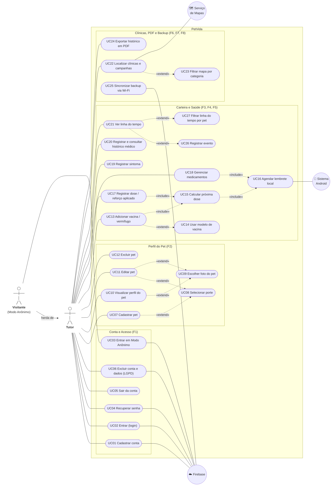

# Diagrama de Casos de Uso — PetVida

Versão revisada contra o código do protótipo (`lib/screens/*.dart`, `lib/services/*.dart`, `firestore.rules`). Incorpora as regras de negócio definidas após a revisão dos requisitos (lembrete automático, Porte no lugar de Raça, backup apenas via Wi-Fi, fluxo em 3 interações e exclusão definitiva de dados).

> O diagrama usa Mermaid, que o GitHub renderiza direto no navegador. Mermaid não tem um tipo nativo de caso de uso, então a notação UML foi adaptada: **atores humanos** (Tutor e Visitante) são bonequinhos, os **atores externos** (Firebase, Android e Mapas) são círculos, **casos de uso** são elipses (cápsulas), a **fronteira do sistema** é o retângulo "PetVida", e as setas tracejadas indicam `«include»` e `«extend»`. Os nomes de classes citados são os mesmos de [`diagrama-de-classes.md`](diagrama-de-classes.md).

---

## 1. Atores

| Ator | Tipo | Descrição |
|---|---|---|
| **Tutor** | Primário | Usuário com conta (e-mail e senha), representado pela classe `Usuario` com `isAnonimo = false`. Pode usar todas as funcionalidades. |
| **Visitante** | Primário | Usuário em **Modo Anônimo** (`signInAnonymously` do Firebase Auth; `Usuario.isAnonimo = true`). Depois de entrar, herda os casos de uso do Tutor, exceto os ligados a credenciais (UC01, UC02 e UC04). Pode sair (UC05) e excluir a conta (UC06) sem informar senha. |
| **Firebase** | Secundário | Autenticação (Firebase Auth) e backup em nuvem (Cloud Firestore). As regras do Firestore só liberam leitura e escrita em `users/{uid}/**` para o próprio usuário autenticado. |
| **Sistema Android** | Secundário | Agenda e exibe as notificações locais (`flutter_local_notifications`), inclusive com o app fechado. |
| **Serviço de Mapas** | Secundário | Busca de clínicas e CCZ próximos (Nominatim, com a Overpass API como reserva, sobre dados do OpenStreetMap) e localização do aparelho (GPS via `geolocator`). |

---

## 2. Diagrama

> **Leitura das setas:** `«include»` aponta para um passo que sempre acontece dentro do caso de uso de origem; `«extend»` aponta para um comportamento opcional, que o tutor aciona ou não. O porte (UC08) é `«extend»` porque o formulário mostra o seletor, mas não obriga a escolha. A foto (UC09) não faz parte do cadastro: ela é escolhida tocando na foto do perfil (UC10) ou no formulário de edição (UC11).

---

## 3. Descrição dos casos de uso

| Código | Caso de uso | Ator | Requisitos | Regras | Classes / onde está no código |
|---|---|---|---|---|---|
| UC01 | Cadastrar conta | Tutor | RF01 | — | `Usuario.cadastrar` — `register_screen.dart` (e-mail, senha e confirmação; abre a tela inicial em seguida) |
| UC02 | Entrar (login) | Tutor | RF01 | RN09 | `Usuario.entrar` — `login_screen.dart` |
| UC03 | Entrar em Modo Anônimo | Visitante | RF01, RNF03 | RN07 | `Usuario.entrarAnonimo` — `login_screen.dart` |
| UC04 | Recuperar senha | Tutor | RF01 | — | `Usuario.recuperarSenha` — `forgot_password_screen.dart` (e-mail de redefinição do Firebase) |
| UC05 | Sair da conta | Tutor / Visitante | RF01 | RN07 | `Usuario.sair` — `perfil_screen.dart` (pede confirmação; no Modo Anônimo avisa que os dados ficam inacessíveis) |
| UC06 | Excluir conta e dados | Tutor / Visitante | RF01, RF12, RNF03 | RN08 | `Usuario.excluirContaEDados`, `SyncService.comRedeLiberada`, `NotificationService.cancelarTudo` — `perfil_screen.dart` |
| UC07 | Cadastrar pet | Tutor | RF02 | RN05 | `Pet` (nome e espécie obrigatórios; idade, peso e porte opcionais) — `meus_pets_screen.dart` |
| UC08 | Selecionar porte | Tutor | RF02 | RN05 | `Porte` — `widgets/porte_selector.dart` |
| UC09 | Escolher foto do pet | Tutor | RF02 | — | `Pet.fotoBase64` (galeria ou câmera, até 400×400, qualidade 70) — `pet_profile_screen.dart` |
| UC10 | Visualizar perfil do pet | Tutor | RF02, RF10 | RN04, RN09 | `Pet`, `Vacina`, `ReminderStatus` — `pet_profile_screen.dart` (aberto pela tela inicial ou por "Meus Pets") |
| UC11 | Editar pet | Tutor | RF02 | RN05 | `Pet.editar` — `pet_profile_screen.dart` (botão de edição ou "Configurações do Pet") |
| UC12 | Excluir pet | Tutor | RF02, RF12 | RN08 | `Pet.excluir` — `pet_profile_screen.dart` (pede confirmação) |
| UC13 | Adicionar vacina / vermífugo | Tutor | RF03, RF04, RNF01 | RN02, RN06, RN09 | `Vacina` — `pet_profile_screen.dart` (botão "Adicionar Vacina") |
| UC14 | Usar modelo de vacina | Tutor | RF04 | RN02 | `ProtocoloVacina` (V8, V10, Antirrábica, V4 Felina, Vermífugo) |
| UC15 | Calcular próxima dose | Sistema | RF04 | RN02 | `Vacina.calcularProximaDose` |
| UC16 | Agendar lembrete local | Sistema → Android | RF05, RNF06 | RN01, RN10 | `NotificationService.agendarLembreteVacina` / `agendarLembreteMedicamento` |
| UC17 | Registrar dose / reforço aplicado | Tutor | RF03, RF04 | RN02, RN06 | `Vacina.registrarDose` — `pet_profile_screen.dart` |
| UC18 | Gerenciar medicamentos | Tutor | — (extra) | RN10 | `Medicamento`, `DoseMedicamento` — `medicamentos_screen.dart` (adicionar, registrar dose, ver doses, remover) |
| UC19 | Registrar sintoma | Tutor | RF06 | RN03 | `Sintoma`, `Severidade` — `symptom_diary_screen.dart` |
| UC20 | Registrar e consultar histórico médico | Tutor | — (extra) | — | `RegistroHistorico` (descrição e data) — `historico_medico_screen.dart` |
| UC21 | Ver linha do tempo | Tutor | — (tela principal) | — | `Evento` — `timeline_screen.dart` |
| UC22 | Localizar clínicas e campanhas | Tutor | RF07 | RN11 | `Clinica`, `Campanha` — `clinics_screen.dart` (mapa, lista, busca por texto e distância) |
| UC23 | Filtrar mapa por categoria | Tutor | RF08 | RN11 | `CategoriaLocal` — `clinics_screen.dart` |
| UC24 | Exportar histórico em PDF | Tutor | RF09 | — | `Pet.exportarHistoricoPdf` — `pet_profile_screen.dart` (dados do pet, vacinas e sintomas) |
| UC25 | Sincronizar backup via Wi-Fi | Sistema → Firebase | RF10, RF11, RNF02 | RN04 | `SyncService` (`initialize`, `gravar`, `backupAtivo`) |
| UC26 | Registrar evento | Tutor | — (tela principal) | — | `Evento` (título, subtítulo, data em texto livre e pet) — `timeline_screen.dart` |
| UC27 | Filtrar linha do tempo por pet | Tutor | — (tela principal) | — | `Evento.pet` — `timeline_screen.dart` |

---

## 4. Regras de negócio

| Código | Regra | Onde se aplica |
|---|---|---|
| **RN01** | O lembrete de vacina é disparado **7 dias antes** da próxima dose prevista. Se essa data já passou, o aviso é exibido em seguida (cerca de 10 segundos após o registro). Ao registrar nova dose, o lembrete anterior é cancelado e reagendado; se não houver próxima dose, ele é apenas cancelado. | UC13, UC16, UC17 |
| **RN02** | A próxima dose é **calculada automaticamente**: durante o protocolo, `data da aplicação + frequência entre doses`; depois da última dose, `data da aplicação + reforço` (ex.: anual). Só fica sem próxima dose quando o intervalo aplicável é 0. Na primeira dose o tutor escolhe a data de aplicação; nas doses seguintes, vale a data do momento do registro. Completado o protocolo, `doseAtual` para em `numeroDoses` e cada nova aplicação conta como reforço. Os modelos preenchem esses valores, que continuam editáveis: V8, V10 e V4 Felina (3 doses a cada 21 dias, reforço de 365 dias); Antirrábica (1 dose, reforço de 365 dias); Vermífugo (1 dose, reforço de 90 dias). | UC13, UC14, UC15, UC17 |
| **RN03** | Um sintoma **não pode ser editado** depois de registrado, para preservar a ordem cronológica do diário. A data e a hora são as do momento do registro (não são digitadas). Para corrigir, registra-se uma nova ocorrência. O sintoma aponta para o pet **pelo nome**. | UC19 |
| **RN04** | **Offline-First**: os dados ficam sempre no cache local do Firestore e a carteira pode ser consultada sem internet. O backup no Firebase só ocorre em **Wi-Fi** (ou cabo Ethernet). Em dados móveis ou sem conexão, a rede do Firestore fica pausada e as gravações ficam pendentes até o próximo Wi-Fi. | UC10, UC25 |
| **RN05** | O pet é classificado por **Porte (Pequeno, Médio ou Grande)** e não por raça, porque tutores de SRD (vira-latas) nem sempre sabem a raça exata. O porte é **opcional**; na edição, deixar sem seleção mantém o porte já salvo. | UC07, UC08, UC11 |
| **RN06** | Cada aplicação de vacina pode informar **lote** e **responsável** (campos opcionais), que podem mudar de uma dose para outra. A `Vacina` guarda apenas os valores da **última** aplicação. | UC13, UC17 |
| **RN07** | O **Modo Anônimo** permite usar o app sem informar e-mail. Os dados ficam vinculados ao `uid` anônimo; ao sair, o acesso a eles é perdido (o app avisa antes de confirmar). | UC03, UC05 |
| **RN08** | A **exclusão da conta é definitiva e em cascata**: apaga pets, vacinas, medicamentos e suas doses, histórico médico, sintomas e eventos, além de todos os lembretes locais e do usuário no Firebase Auth. Para contas com e-mail, a senha é pedida de novo (reautenticação); no Modo Anônimo, não. Essa ação libera a rede mesmo fora do Wi-Fi, para apagar também o backup. A **exclusão de um pet** é confirmada pelo tutor, apaga o pet e suas vacinas e cancela os lembretes dessas vacinas, seguindo a política normal de Wi-Fi (ver limitações na seção 5). | UC06, UC12 |
| **RN09** | A função principal deve levar no máximo **3 interações**: *Abrir → Tocar no pet → "Adicionar Vacina"*. Com a sessão salva, o app abre direto na tela inicial, que já lista os pets. | UC02, UC10, UC13 |
| **RN10** | Medicamentos têm frequência em **horas** e quantidade de doses. Cada aplicação gera um `DoseMedicamento`, e o lembrete é agendado para o **horário exato** da próxima dose. Após a última dose, ou ao remover o medicamento, o lembrete é cancelado. | UC16, UC18 |
| **RN11** | Clínicas, CCZ e campanhas são **somente leitura** para o tutor e não são gravadas no Firestore. Clínicas e CCZ vêm do OpenStreetMap (Nominatim, com Overpass como reserva) num raio de cerca de 8 km da localização do aparelho; a classificação como CCZ é feita pelo nome e pela tag `operator:type`. As campanhas (vacinação gratuita e castração) são fixas no app. O mapa pode ser filtrado por: clínica, CCZ, vacinação gratuita e castração. | UC22, UC23 |

---

## 5. Situação de implementação (protótipo atual)

| Caso de uso | Situação |
|---|---|
| UC01–UC27 | Implementados no app Flutter. |
| UC01 (edição da conta) | O RF01 cita edição da conta, mas o protótipo não tem tela para alterar e-mail ou senha. A troca de senha só é possível pelo fluxo de recuperação (UC04). |
| UC12 (exclusão de pet) | A exclusão apaga o pet e a subcoleção `vacinas`, mas não apaga `medicamentos` (nem suas `doses`) nem `historico`, que ficam órfãos no Firestore. Os lembretes de medicamentos desse pet também não são cancelados. Sintomas e eventos, que apontam para o pet pelo nome, continuam existindo. Esses dados só saem de vez com a exclusão da conta (UC06). |
| UC18 (remover medicamento) | A remoção apaga o documento do medicamento e cancela o lembrete, mas a subcoleção `doses` fica órfã no Firestore. |
| UC19 (exclusão de sintoma individual) | O mapeamento CRUD prevê exclusão de sintomas, mas o protótipo ainda não tem esse botão. Hoje os sintomas só são apagados junto com a conta (UC06). |
| UC20 (histórico médico) | Só permite adicionar e listar registros; não há edição nem exclusão individual. |
| UC21 (linha do tempo) | Mostra apenas os eventos registrados manualmente (UC26). Vacinas e medicamentos não geram eventos automaticamente. |
| UC24 (PDF) | O PDF contém os dados do pet, as vacinas e o diário de sintomas. Histórico médico e medicamentos não entram no relatório. |
