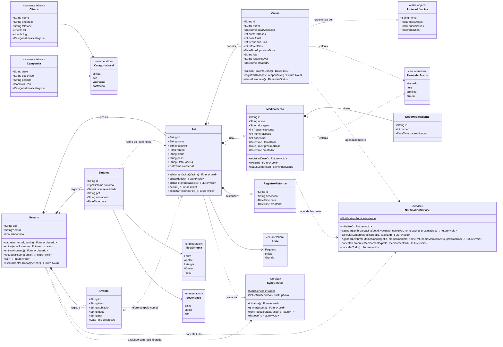

# Diagrama de Classes (Modelos de Domínio) — PetVida

Este documento mostra as principais entidades do domínio do PetVida, com seus atributos, métodos principais e relacionamentos. Também inclui os serviços que aplicam as regras de negócio (lembretes e sincronização).

> **Observação sobre o código atual:** no protótipo, as telas (`lib/screens/*.dart`) leem e gravam os documentos do Firestore diretamente como `Map<String, dynamic>`. Não existem classes de modelo persistidas. As classes abaixo formam o **modelo de domínio** que esses mapas representam: os atributos têm os mesmos nomes dos campos gravados no Firestore. Os métodos correspondem às ações que as telas executam sobre cada documento (ex.: `Vacina.registrarDose()` corresponde a `_handleRegistrarProximaDose` em `pet_profile_screen.dart`). A seção 5 resume onde cada classe está no código; o mapeamento detalhado entre Dart e Firestore está em [`mapeamento-dart-firestore.md`](mapeamento-dart-firestore.md).

---

## 1. Diagrama

> Para não poluir o diagrama, só a dependência `Pet ..> SyncService` foi desenhada. Na prática, **toda** gravação de Pet, Vacina, Medicamento, DoseMedicamento, RegistroHistorico, Sintoma e Evento passa por `SyncService.instance.gravar(...)`. `NotificationService` e `SyncService` são singletons, acessados por `instance`.

---

## 2. Entidades

### Usuario
Representa o tutor autenticado pelo **Firebase Auth**: conta com e-mail e senha ou **Modo Anônimo** (`isAnonimo`, lido de `currentUser.isAnonymous`). É a raiz de todos os dados (`users/{uid}`), mas o documento `users/{uid}` em si não tem campos gravados: ele só serve de caminho para as subcoleções. As regras do Firestore (`firestore.rules`) permitem leitura e escrita em `users/{uid}/**` apenas quando `request.auth.uid == uid`.

Os métodos correspondem às chamadas do Firebase Auth nas telas:
- `cadastrar`: `createUserWithEmailAndPassword` (`register_screen.dart`);
- `entrar`: `signInWithEmailAndPassword`. `entrarAnonimo`: `signInAnonymously` (`login_screen.dart`);
- `recuperarSenha`: `sendPasswordResetEmail` (`forgot_password_screen.dart`);
- `sair`: `signOut`. `excluirContaEDados`: veja abaixo (`perfil_screen.dart`).

`excluirContaEDados(senha?)` atende ao RF12/LGPD. A senha só é exigida em contas com e-mail, para reautenticar. O método libera a rede (`SyncService.comRedeLiberada`) e apaga em cascata `vacinas`, `medicamentos` (com suas `doses`) e `historico` de cada pet, depois os pets, `sintomas`, `eventos` e o documento do usuário. Em seguida cancela todos os lembretes (`NotificationService.cancelarTudo`) e exclui a conta do Auth.

### Pet
Perfil individual do animal (`users/{uid}/pets/{petId}`).
- `porte` substitui o antigo campo raça. É gravado como texto com um dos valores `'Pequeno'`, `'Médio'` ou `'Grande'` (`portesPet` em `widgets/porte_selector.dart`). Pode estar ausente em pets cadastrados antes do campo existir.
- `idade` e `peso` são texto livre digitado pelo tutor.
- `fotoBase64` guarda a foto direto no documento, o que dispensa o Firebase Storage. A foto vem da galeria ou da câmera (ImagePicker), com no máximo 400×400 e qualidade 70.
- `exportarHistoricoPdf()` gera um PDF (RF09) com os dados do pet, as vacinas e os sintomas cujo campo `pet` é igual ao nome do pet.
- `excluir()` apaga as vacinas do pet (e cancela os lembretes delas) e depois o documento do pet. Veja o ponto de melhoria 5.

### Vacina
Uma vacina ou vermífugo da carteira digital (`pets/{petId}/vacinas`). Um único documento acompanha o protocolo inteiro:
- `doseAtual` vai de 1 a `numeroDoses`. Depois de completar o protocolo, cada nova aplicação é um reforço e o contador fica parado em `numeroDoses`;
- `calcularProximaDose()` aplica a regra RN02/RF04: soma `frequenciaDias` enquanto `doseAtual < numeroDoses` e `reforcoDias` depois disso. Retorna `null` quando o intervalo é 0;
- `registrarDose(lote, responsavel)` atualiza `doseAtual`, `dataAplicacao`, `proximaDose`, `lote` e `responsavel` e reagenda o lembrete;
- `lote` e `responsavel` guardam os dados da **última** aplicação;
- `statusLembrete()` aplica `calcularReminderStatus(proximaDose)` (`utils/reminder_status.dart`).

Não há edição nem exclusão individual de vacina no app.

### ProtocoloVacina
Objeto de valor com as regras padrão de cada imunizante. Não é persistido: só preenche o formulário, cujos campos continuam editáveis.

| Protocolo | numeroDoses | frequenciaDias | reforcoDias |
|---|---|---|---|
| V8 | 3 | 21 | 365 |
| V10 | 3 | 21 | 365 |
| Antirrábica | 1 | 365 | 365 |
| V4 Felina | 3 | 21 | 365 |
| Vermífugo | 1 | 90 | 90 |

### Medicamento e DoseMedicamento
Tratamento em andamento (`pets/{petId}/medicamentos`), com frequência em horas.
- Ao criar, já grava `doseAtual = 1`, `ultimaDose = agora` e a primeira `DoseMedicamento` (subcoleção `doses`).
- `registrarDose()` incrementa `doseAtual`, atualiza `ultimaDose` e grava uma nova `DoseMedicamento` com `numero` e `dataAplicacao`. As doses formam o histórico completo de administração.
- `proximaDose` é `ultimaDose + frequenciaHoras` enquanto houver doses restantes. Fica `null` quando o tratamento termina ("Protocolo completo").
- `excluir()` apaga o documento e cancela o lembrete. Veja o ponto de melhoria 5.

### RegistroHistorico
Entrada livre do histórico médico do pet (`pets/{petId}/historico`): consultas, exames, procedimentos. `data` é escolhida pelo tutor e `createdAt` é o horário do servidor. O app só cria e lista (ordenado por `data`); não há edição nem exclusão.

### Sintoma
Ocorrência do diário de sintomas (RF06), em `users/{uid}/sintomas`. Não é editável (RN03).
- `sintoma` e `severidade` são gravados como texto: o rótulo do sintoma escolhido (`TipoSintoma`) e `'Baixo'`, `'Médio'` ou `'Alto'`. A severidade vem do slider de 3 posições.
- `data` é o `serverTimestamp` do momento do registro. Não existe `createdAt` separado.
- Fica no nível do usuário e aponta para o pet **pelo nome** (`pet`), não pelo id.

### Evento
Item da linha do tempo (`users/{uid}/eventos`). Também fica no nível do usuário e aponta para o pet pelo nome. O campo `data` é texto livre (ex.: "Hoje", "12/11"; vale "Hoje" se ficar vazio). A lista é ordenada por `createdAt`. O ícone e a cor exibidos na tela são fixos e não são gravados.

### Clinica e Campanha
Dados **somente leitura** (CRUD só com R), que nunca são gravados no Firestore.
- As clínicas vêm das APIs Nominatim/Overpass (OpenStreetMap). A `categoria` é `ccz` quando o nome ou a tag `operator:type` indica serviço público, e `clinica` nos outros casos.
- As campanhas são fixas no app e usam as categorias `vacinacao` e `castracao`. `icon` é só de apresentação.

### ReminderStatus
Classificação da `proximaDose` de vacinas e medicamentos: `atrasado` (data já passou), `hoje` (menos de 24 h), `proximo` (até 3 dias) e `emDia` (mais de 3 dias).

### NotificationService
Singleton de notificações locais agendadas (RF05/RNF06), com `flutter_local_notifications`. O lembrete de vacina dispara **7 dias antes** da `proximaDose`. O de medicamento dispara **no horário exato** da dose. Agendar um lembrete cancela o anterior com o mesmo id, e um horário que já passou é adiado para alguns segundos no futuro.

### SyncService
Singleton da política Offline-First (RF10, RF11, RNF02). Ativa o cache local ilimitado do Firestore e só libera a rede em Wi-Fi ou Ethernet; `backupAtivo` indica quando a rede está ligada. `gravar` não espera a confirmação do servidor quando o backup está pausado. `comRedeLiberada` força a rede durante uma ação explícita do tutor (a exclusão de conta).

---

## 3. Relacionamentos

| Relação | Tipo | Multiplicidade | Significado |
|---|---|---|---|
| Usuario → Pet | Composição | 1 → 0..* | Pets só existem dentro de um usuário (`users/{uid}/pets`) e são apagados com ele. |
| Pet → Vacina / Medicamento / RegistroHistorico | Composição | 1 → 0..* | Subcoleções do pet. Na exclusão da conta são apagadas com ele; na exclusão do pet, só as vacinas (ponto de melhoria 5). |
| Medicamento → DoseMedicamento | Composição | 1 → 1..* | Toda criação de medicamento já grava a dose 1. |
| Usuario → Sintoma / Evento | Composição | 1 → 0..* | Coleções do usuário, apagadas na exclusão da conta. |
| Sintoma / Evento → Pet | Dependência | 0..* → 1 | Referência fraca, feita pelo nome do pet. |
| Pet → Porte | Associação | 0..* → 0..1 | Porte opcional, gravado como texto. |
| Sintoma → TipoSintoma / Severidade | Associação | 0..* → 1 | Valores gravados como texto. |
| Vacina → ProtocoloVacina | Dependência | — | O protocolo só preenche o formulário de cadastro. |
| Vacina / Medicamento → ReminderStatus | Dependência | — | Status calculado na hora a partir de `proximaDose`. |
| Clinica / Campanha → CategoriaLocal | Associação | 0..* → 1 | Usada no filtro do mapa (RF08). |
| Vacina / Medicamento → NotificationService | Dependência | — | Ao criar, registrar dose ou excluir, agenda ou cancela o lembrete local. |
| Usuario → NotificationService | Dependência | — | `cancelarTudo()` na exclusão da conta. |
| Telas → SyncService | Dependência | — | Toda gravação passa por `SyncService.gravar`. A exclusão da conta usa `comRedeLiberada`. |

---

## 4. Pontos de melhoria identificados na modelagem

1. **Referência pelo nome em Sintoma e Evento**: renomear um pet quebra o vínculo com os registros antigos, inclusive no PDF exportado, que filtra sintomas por `pet == nome`. A recomendação é gravar também `petId`.
2. **`Evento.data` como texto**: impede ordenar por data real. A ordenação hoje usa `createdAt`. A recomendação é gravar um `Timestamp`.
3. **Histórico de doses de vacina**: diferente de `Medicamento`, a `Vacina` guarda só a última aplicação (data, lote e responsável). Uma subcoleção `aplicacoes` preservaria o histórico de cada dose.
4. **`idade` e `peso` como texto**: guardar `dataNascimento` (Timestamp) e `pesoKg` (número) permitiria calcular a idade e acompanhar a evolução do peso.
5. **Exclusão em cascata incompleta**: o Firestore não apaga subcoleções sozinho.
   - `Pet.excluir()` apaga só `vacinas`, então `medicamentos`, `doses` e `historico` do pet ficam órfãos e os lembretes de medicamento não são cancelados.
   - `Medicamento.excluir()` não apaga a subcoleção `doses`.

   A exclusão da conta não tem esse problema, porque percorre todas as subcoleções.
6. **Enumerações gravadas como rótulo**: `porte`, `sintoma` e `severidade` são gravados como texto de exibição (com acento). Mudar um rótulo na interface quebra a leitura dos dados antigos. Por exemplo, uma severidade não reconhecida vira `Médio`.

---

## 5. Mapeamento classe → código

| Classe | Caminho no Firestore | Onde está no código |
|---|---|---|
| Usuario | `users/{uid}` (Firebase Auth) | `login_screen.dart`, `register_screen.dart`, `forgot_password_screen.dart`, `perfil_screen.dart` |
| Pet | `users/{uid}/pets/{petId}` | `meus_pets_screen.dart` (criação), `pet_profile_screen.dart` (edição, foto, exclusão, PDF), `home_screen.dart` (listagem) |
| Porte | campo `porte` | `widgets/porte_selector.dart` (`portesPet`) |
| Vacina | `.../pets/{petId}/vacinas/{id}` | `pet_profile_screen.dart` (`_calcularProximaDose`, `_RegistrarDoseVacinaDialog`) |
| ProtocoloVacina | — (não persistido) | `pet_profile_screen.dart` (`_ProtocoloVacina`, `_protocolosVacina`) |
| Medicamento | `.../pets/{petId}/medicamentos/{id}` | `medicamentos_screen.dart` |
| DoseMedicamento | `.../medicamentos/{id}/doses/{id}` | `medicamentos_screen.dart` (`_DosesDialog`) |
| RegistroHistorico | `.../pets/{petId}/historico/{id}` | `historico_medico_screen.dart` |
| Sintoma, TipoSintoma, Severidade | `users/{uid}/sintomas/{id}` | `symptom_diary_screen.dart` (`_SymptomRecord`, `_Symptom`, `_Severity`) |
| Evento | `users/{uid}/eventos/{id}` | `timeline_screen.dart` (`_TimelineEvent`) |
| Clinica, Campanha, CategoriaLocal | — (APIs externas / fixos) | `clinics_screen.dart` (`_Clinic`, `_Campaign`, `_Categoria`) |
| ReminderStatus | — (calculado) | `utils/reminder_status.dart` |
| NotificationService | — | `services/notification_service.dart` |
| SyncService | — | `services/sync_service.dart` |
