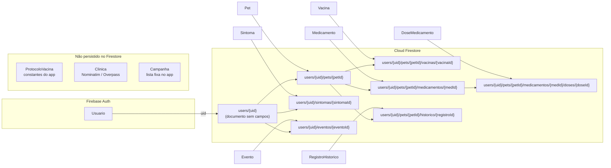

# Mapeamento Dart ↔ Firestore — PetVida

Este documento mostra como cada classe de domínio de [`diagrama-de-classes.md`](diagrama-de-classes.md) corresponde a um documento do **Cloud Firestore**: o caminho da coleção, a tabela atributo Dart ↔ campo Firestore e um trecho de código com `fromFirestore` / `toFirestore`.

> **Importante: estado atual × proposta.** Hoje as telas (`lib/screens/*.dart`) **não usam classes de modelo**. Elas leem e gravam os documentos direto como `Map<String, dynamic>`, por exemplo `(data['doseAtual'] as num?)?.toInt() ?? 1` em `pet_profile_screen.dart` ou `collection.doc().set({'nome': ..., 'createdAt': FieldValue.serverTimestamp()})` em `meus_pets_screen.dart`. As classes e os trechos de código abaixo são o **modelo de domínio / refatoração proposta**. Eles reproduzem os mesmos campos, tipos e conversões que as telas já fazem, só que concentrados em um lugar. **Nenhum campo foi inventado**: todos os nomes vêm do código atual.

---

## 1. Visão geral: classe → coleção



| Classe | Caminho da coleção | Arquivo(s) que leem/gravam hoje |
|---|---|---|
| `Usuario` | Firebase Auth (`uid`, `email`, `isAnonymous`); `users/{uid}` serve só de raiz | `login_screen.dart`, `register_screen.dart`, `perfil_screen.dart` |
| `Pet` | `users/{uid}/pets` | `meus_pets_screen.dart`, `home_screen.dart`, `pet_profile_screen.dart` |
| `Vacina` | `users/{uid}/pets/{petId}/vacinas` | `pet_profile_screen.dart` |
| `Medicamento` | `users/{uid}/pets/{petId}/medicamentos` | `medicamentos_screen.dart` |
| `DoseMedicamento` | `users/{uid}/pets/{petId}/medicamentos/{medId}/doses` | `medicamentos_screen.dart` |
| `RegistroHistorico` | `users/{uid}/pets/{petId}/historico` | `historico_medico_screen.dart` |
| `Sintoma` | `users/{uid}/sintomas` | `symptom_diary_screen.dart`, `pet_profile_screen.dart` (PDF) |
| `Evento` | `users/{uid}/eventos` | `timeline_screen.dart` |
| `ProtocoloVacina`, `Clinica`, `Campanha` | — (não persistidos) | `pet_profile_screen.dart`, `clinics_screen.dart` |

**Segurança** (`firestore.rules`): tudo fica sob `users/{userId}` e só pode ser lido ou gravado quando `request.auth.uid == userId`, inclusive as subcoleções (`match /{document=**}`). Por isso o `uid` não é gravado como campo: ele já está no caminho.

**Gravação**: toda escrita passa por `SyncService.instance.gravar(...)` (política Offline-First). Os `toFirestore()` abaixo devolvem o mapa que vai dentro dessa chamada.

---

## 2. Convenções de conversão

| Situação | Dart | Firestore | Como converter |
|---|---|---|---|
| Datas | `DateTime` | `timestamp` | Leitura: `(m['campo'] as Timestamp?)?.toDate()`. Escrita: `Timestamp.fromDate(valor)` |
| Data de criação | `DateTime` | `timestamp` | Escrita: `FieldValue.serverTimestamp()` (o servidor preenche). Na leitura logo após gravar offline o campo pode vir `null` (escrita pendente), então use um fallback |
| Inteiros | `int` | `number` | Leitura: `(m['campo'] as num?)?.toInt() ?? padrao`. O Firestore pode devolver `int` ou `double`, por isso o código usa `num` e nunca `as int` na leitura |
| Enum `Porte` | `Porte.pequeno/medio/grande` | `string` `'Pequeno'` / `'Médio'` / `'Grande'` | Mesmos rótulos de `portesPet` em `widgets/porte_selector.dart` |
| Enum `Severidade` | `Severidade.baixo/medio/alto` | `string` `'Baixo'` / `'Médio'` / `'Alto'` | Mesmos rótulos de `_Severity.label` em `symptom_diary_screen.dart`; valor desconhecido vira `medio` (igual a `_severidadeFromLabel`) |
| Opcionais | `T?` | campo ausente ou `null` | `proximaDose == null` significa protocolo concluído |
| Id do documento | `String id` | — (não é campo) | Vem de `doc.id` |

Base comum dos trechos de código:

```dart
import 'package:cloud_firestore/cloud_firestore.dart';

DateTime? _data(Object? valor) => (valor as Timestamp?)?.toDate();
int _inteiro(Object? valor, int padrao) => (valor as num?)?.toInt() ?? padrao;
```

---

## 3. Classes persistidas

### 3.1 `Usuario`

`Usuario` vem do **Firebase Auth**, não de um documento. O documento `users/{uid}` não tem campos gravados pelo app; ele só agrupa as subcoleções e é o alvo da regra de segurança.

| Atributo Dart | Tipo Dart | Origem | Tipo |
|---|---|---|---|
| `uid` | `String` | `User.uid` (também é o id de `users/{uid}`) | `string` |
| `email` | `String?` | `User.email` | `string` / `null` no modo anônimo |
| `isAnonimo` | `bool` | `User.isAnonymous` | `bool` |

```dart
class Usuario {
  Usuario({required this.uid, this.email, required this.isAnonimo});

  final String uid;
  final String? email;
  final bool isAnonimo;

  factory Usuario.fromAuth(User user) => Usuario(
        uid: user.uid,
        email: user.email,
        isAnonimo: user.isAnonymous,
      );

  DocumentReference<Map<String, dynamic>> get documento =>
      FirebaseFirestore.instance.collection('users').doc(uid);
}
```

### 3.2 `Pet`

**Coleção:** `users/{uid}/pets` — ordenada por `createdAt`.

| Atributo Dart | Tipo Dart | Campo Firestore | Tipo Firestore | Observação |
|---|---|---|---|---|
| `id` | `String` | *(id do documento)* | — | `doc.id` |
| `nome` | `String` | `nome` | `string` | |
| `especie` | `String` | `especie` | `string` | |
| `porte` | `Porte?` | `porte` | `string` | `'Pequeno'` / `'Médio'` / `'Grande'`; pode faltar em pets antigos |
| `idade` | `String` | `idade` | `string` | texto livre |
| `peso` | `String` | `peso` | `string` | texto livre |
| `fotoBase64` | `String?` | `fotoBase64` | `string` | JPEG 400×400 em Base64; gravado depois via `update` |
| `createdAt` | `DateTime` | `createdAt` | `timestamp` | `FieldValue.serverTimestamp()` |

```dart
enum Porte {
  pequeno('Pequeno'),
  medio('Médio'),
  grande('Grande');

  const Porte(this.rotulo);
  final String rotulo;

  static Porte? fromFirestore(String? valor) {
    for (final porte in Porte.values) {
      if (porte.rotulo == valor) return porte;
    }
    return null;
  }
}

class Pet {
  Pet({
    required this.id,
    required this.nome,
    required this.especie,
    this.porte,
    required this.idade,
    required this.peso,
    this.fotoBase64,
    required this.createdAt,
  });

  final String id;
  final String nome;
  final String especie;
  final Porte? porte;
  final String idade;
  final String peso;
  final String? fotoBase64;
  final DateTime createdAt;

  factory Pet.fromFirestore(DocumentSnapshot<Map<String, dynamic>> doc) {
    final m = doc.data() ?? {};
    return Pet(
      id: doc.id,
      nome: (m['nome'] as String?)?.trim() ?? '',
      especie: (m['especie'] as String?)?.trim() ?? '',
      porte: Porte.fromFirestore(m['porte'] as String?),
      idade: (m['idade'] as String?)?.trim() ?? '',
      peso: (m['peso'] as String?)?.trim() ?? '',
      fotoBase64: m['fotoBase64'] as String?,
      createdAt: _data(m['createdAt']) ?? DateTime.now(),
    );
  }

  Map<String, dynamic> toFirestore() => {
        'nome': nome,
        'especie': especie,
        'porte': porte?.rotulo,
        'idade': idade,
        'peso': peso,
        'createdAt': FieldValue.serverTimestamp(),
      };
}
```

> `toFirestore()` é o mapa da **criação** (igual ao `set` de `meus_pets_screen.dart`). A edição em `pet_profile_screen.dart` usa `update` só com os campos alterados e só inclui `porte`/`fotoBase64` quando mudaram, para não apagar valores existentes.

### 3.3 `Vacina`

**Coleção:** `users/{uid}/pets/{petId}/vacinas` — ordenada por `dataAplicacao` (desc.).

| Atributo Dart | Tipo Dart | Campo Firestore | Tipo Firestore | Observação |
|---|---|---|---|---|
| `id` | `String` | *(id do documento)* | — | |
| `nome` | `String` | `nome` | `string` | |
| `dataAplicacao` | `DateTime` | `dataAplicacao` | `timestamp` | data da **última** dose aplicada |
| `numeroDoses` | `int` | `numeroDoses` | `number` | |
| `doseAtual` | `int` | `doseAtual` | `number` | começa em 1 |
| `frequenciaDias` | `int` | `frequenciaDias` | `number` | intervalo durante o protocolo |
| `reforcoDias` | `int` | `reforcoDias` | `number` | intervalo do reforço |
| `proximaDose` | `DateTime?` | `proximaDose` | `timestamp` / `null` | `null` = protocolo concluído |
| `lote` | `String` | `lote` | `string` | da última aplicação |
| `responsavel` | `String` | `responsavel` | `string` | da última aplicação |
| `createdAt` | `DateTime` | `createdAt` | `timestamp` | `FieldValue.serverTimestamp()` |

```dart
class Vacina {
  Vacina({
    required this.id,
    required this.nome,
    required this.dataAplicacao,
    required this.numeroDoses,
    required this.doseAtual,
    required this.frequenciaDias,
    required this.reforcoDias,
    this.proximaDose,
    required this.lote,
    required this.responsavel,
    required this.createdAt,
  });

  final String id;
  final String nome;
  final DateTime dataAplicacao;
  final int numeroDoses;
  final int doseAtual;
  final int frequenciaDias;
  final int reforcoDias;
  final DateTime? proximaDose;
  final String lote;
  final String responsavel;
  final DateTime createdAt;

  factory Vacina.fromFirestore(DocumentSnapshot<Map<String, dynamic>> doc) {
    final m = doc.data() ?? {};
    return Vacina(
      id: doc.id,
      nome: (m['nome'] as String?) ?? 'Vacina',
      dataAplicacao: _data(m['dataAplicacao']) ?? DateTime.now(),
      numeroDoses: _inteiro(m['numeroDoses'], 1),
      doseAtual: _inteiro(m['doseAtual'], 1),
      frequenciaDias: _inteiro(m['frequenciaDias'], 0),
      reforcoDias: _inteiro(m['reforcoDias'], 0),
      proximaDose: _data(m['proximaDose']),
      lote: (m['lote'] as String?)?.trim() ?? '',
      responsavel: (m['responsavel'] as String?)?.trim() ?? '',
      createdAt: _data(m['createdAt']) ?? DateTime.now(),
    );
  }

  Map<String, dynamic> toFirestore() => {
        'nome': nome,
        'dataAplicacao': Timestamp.fromDate(dataAplicacao),
        'frequenciaDias': frequenciaDias,
        'numeroDoses': numeroDoses,
        'reforcoDias': reforcoDias,
        'doseAtual': doseAtual,
        'proximaDose':
            proximaDose == null ? null : Timestamp.fromDate(proximaDose!),
        'lote': lote,
        'responsavel': responsavel,
        'createdAt': FieldValue.serverTimestamp(),
      };

  Map<String, dynamic> registrarDoseFirestore({
    required DateTime agora,
    required DateTime? novaProximaDose,
    required String lote,
    required String responsavel,
  }) =>
      {
        'doseAtual': doseAtual + 1,
        'dataAplicacao': Timestamp.fromDate(agora),
        'proximaDose': novaProximaDose == null
            ? null
            : Timestamp.fromDate(novaProximaDose),
        'lote': lote,
        'responsavel': responsavel,
      };
}
```

> `registrarDoseFirestore` corresponde ao `doc.update(...)` de "Registrar dose" em `pet_profile_screen.dart`: atualiza o mesmo documento em vez de criar outro.

### 3.4 `Medicamento`

**Coleção:** `users/{uid}/pets/{petId}/medicamentos` — ordenada por `createdAt` (desc.).

| Atributo Dart | Tipo Dart | Campo Firestore | Tipo Firestore | Observação |
|---|---|---|---|---|
| `id` | `String` | *(id do documento)* | — | |
| `nome` | `String` | `nome` | `string` | |
| `dosagem` | `String` | `dosagem` | `string` | |
| `frequenciaHoras` | `int` | `frequenciaHoras` | `number` | |
| `numeroDoses` | `int` | `numeroDoses` | `number` | |
| `doseAtual` | `int` | `doseAtual` | `number` | começa em 1 |
| `ultimaDose` | `DateTime` | `ultimaDose` | `timestamp` | |
| `proximaDose` | `DateTime?` | `proximaDose` | `timestamp` / `null` | `null` = tratamento concluído |
| `createdAt` | `DateTime` | `createdAt` | `timestamp` | `FieldValue.serverTimestamp()` |

```dart
class Medicamento {
  Medicamento({
    required this.id,
    required this.nome,
    required this.dosagem,
    required this.frequenciaHoras,
    required this.numeroDoses,
    required this.doseAtual,
    required this.ultimaDose,
    this.proximaDose,
    required this.createdAt,
  });

  final String id;
  final String nome;
  final String dosagem;
  final int frequenciaHoras;
  final int numeroDoses;
  final int doseAtual;
  final DateTime ultimaDose;
  final DateTime? proximaDose;
  final DateTime createdAt;

  factory Medicamento.fromFirestore(
    DocumentSnapshot<Map<String, dynamic>> doc,
  ) {
    final m = doc.data() ?? {};
    return Medicamento(
      id: doc.id,
      nome: (m['nome'] as String?) ?? 'Medicamento',
      dosagem: (m['dosagem'] as String?) ?? '',
      frequenciaHoras: _inteiro(m['frequenciaHoras'], 0),
      numeroDoses: _inteiro(m['numeroDoses'], 1),
      doseAtual: _inteiro(m['doseAtual'], 1),
      ultimaDose: _data(m['ultimaDose']) ?? DateTime.now(),
      proximaDose: _data(m['proximaDose']),
      createdAt: _data(m['createdAt']) ?? DateTime.now(),
    );
  }

  Map<String, dynamic> toFirestore() => {
        'nome': nome,
        'dosagem': dosagem,
        'frequenciaHoras': frequenciaHoras,
        'numeroDoses': numeroDoses,
        'doseAtual': doseAtual,
        'ultimaDose': Timestamp.fromDate(ultimaDose),
        'proximaDose':
            proximaDose == null ? null : Timestamp.fromDate(proximaDose!),
        'createdAt': FieldValue.serverTimestamp(),
      };
}
```

> Ao criar um medicamento, `medicamentos_screen.dart` grava o documento **e** a dose 1 na subcoleção `doses`. Ao registrar uma dose, faz `update` de `doseAtual`, `ultimaDose` e `proximaDose` e cria mais um `DoseMedicamento`.

### 3.5 `DoseMedicamento`

**Coleção:** `users/{uid}/pets/{petId}/medicamentos/{medId}/doses` — ordenada por `numero`.

| Atributo Dart | Tipo Dart | Campo Firestore | Tipo Firestore |
|---|---|---|---|
| `id` | `String` | *(id do documento)* | — |
| `numero` | `int` | `numero` | `number` |
| `dataAplicacao` | `DateTime` | `dataAplicacao` | `timestamp` |

```dart
class DoseMedicamento {
  DoseMedicamento({
    required this.id,
    required this.numero,
    required this.dataAplicacao,
  });

  final String id;
  final int numero;
  final DateTime dataAplicacao;

  factory DoseMedicamento.fromFirestore(
    DocumentSnapshot<Map<String, dynamic>> doc,
  ) {
    final m = doc.data() ?? {};
    return DoseMedicamento(
      id: doc.id,
      numero: _inteiro(m['numero'], 1),
      dataAplicacao: _data(m['dataAplicacao']) ?? DateTime.now(),
    );
  }

  Map<String, dynamic> toFirestore() => {
        'numero': numero,
        'dataAplicacao': Timestamp.fromDate(dataAplicacao),
      };
}
```

### 3.6 `RegistroHistorico`

**Coleção:** `users/{uid}/pets/{petId}/historico` — ordenada por `data` (desc.).

| Atributo Dart | Tipo Dart | Campo Firestore | Tipo Firestore | Observação |
|---|---|---|---|---|
| `id` | `String` | *(id do documento)* | — | |
| `descricao` | `String` | `descricao` | `string` | |
| `data` | `DateTime` | `data` | `timestamp` | escolhida no date picker |
| `createdAt` | `DateTime` | `createdAt` | `timestamp` | `FieldValue.serverTimestamp()` |

```dart
class RegistroHistorico {
  RegistroHistorico({
    required this.id,
    required this.descricao,
    required this.data,
    required this.createdAt,
  });

  final String id;
  final String descricao;
  final DateTime data;
  final DateTime createdAt;

  factory RegistroHistorico.fromFirestore(
    DocumentSnapshot<Map<String, dynamic>> doc,
  ) {
    final m = doc.data() ?? {};
    return RegistroHistorico(
      id: doc.id,
      descricao: (m['descricao'] as String?) ?? '',
      data: _data(m['data']) ?? DateTime.now(),
      createdAt: _data(m['createdAt']) ?? DateTime.now(),
    );
  }

  Map<String, dynamic> toFirestore() => {
        'descricao': descricao,
        'data': Timestamp.fromDate(data),
        'createdAt': FieldValue.serverTimestamp(),
      };
}
```

### 3.7 `Sintoma`

**Coleção:** `users/{uid}/sintomas` — ordenada por `data` (desc.). Não há `createdAt`: o próprio `data` é o `serverTimestamp` do registro. Não é editável (RN03), então não existe mapa de `update`.

| Atributo Dart | Tipo Dart | Campo Firestore | Tipo Firestore | Observação |
|---|---|---|---|---|
| `id` | `String` | *(id do documento)* | — | |
| `sintoma` | `String` | `sintoma` | `string` | ex.: `'Febre'`, `'Apetite'`, `'Letargia'`, `'Vômito'` |
| `severidade` | `Severidade` | `severidade` | `string` | `'Baixo'` / `'Médio'` / `'Alto'` |
| `pet` | `String` | `pet` | `string` | **nome** do pet, não o id |
| `anotacoes` | `String` | `anotacoes` | `string` | |
| `data` | `DateTime` | `data` | `timestamp` | `FieldValue.serverTimestamp()` |

```dart
enum Severidade {
  baixo('Baixo'),
  medio('Médio'),
  alto('Alto');

  const Severidade(this.rotulo);
  final String rotulo;

  static Severidade fromFirestore(String? valor) {
    for (final severidade in Severidade.values) {
      if (severidade.rotulo == valor) return severidade;
    }
    return Severidade.medio;
  }
}

class Sintoma {
  Sintoma({
    required this.id,
    required this.sintoma,
    required this.severidade,
    required this.pet,
    required this.anotacoes,
    required this.data,
  });

  final String id;
  final String sintoma;
  final Severidade severidade;
  final String pet;
  final String anotacoes;
  final DateTime data;

  factory Sintoma.fromFirestore(DocumentSnapshot<Map<String, dynamic>> doc) {
    final m = doc.data() ?? {};
    return Sintoma(
      id: doc.id,
      sintoma: (m['sintoma'] as String?) ?? 'Sintoma',
      severidade: Severidade.fromFirestore(m['severidade'] as String?),
      pet: (m['pet'] as String?) ?? 'Pet',
      anotacoes: (m['anotacoes'] as String?) ?? '',
      data: _data(m['data']) ?? DateTime.now(),
    );
  }

  Map<String, dynamic> toFirestore() => {
        'sintoma': sintoma,
        'severidade': severidade.rotulo,
        'pet': pet,
        'anotacoes': anotacoes,
        'data': FieldValue.serverTimestamp(),
      };
}
```

### 3.8 `Evento`

**Coleção:** `users/{uid}/eventos` — ordenada por `createdAt` (desc.), porque `data` é texto.

| Atributo Dart | Tipo Dart | Campo Firestore | Tipo Firestore | Observação |
|---|---|---|---|---|
| `id` | `String` | *(id do documento)* | — | |
| `titulo` | `String` | `titulo` | `string` | |
| `subtitulo` | `String` | `subtitulo` | `string` | |
| `data` | `String` | `data` | `string` | texto livre; vazio vira `'Hoje'` |
| `pet` | `String` | `pet` | `string` | **nome** do pet |
| `createdAt` | `DateTime` | `createdAt` | `timestamp` | `FieldValue.serverTimestamp()` |

```dart
class Evento {
  Evento({
    required this.id,
    required this.titulo,
    required this.subtitulo,
    required this.data,
    required this.pet,
    required this.createdAt,
  });

  final String id;
  final String titulo;
  final String subtitulo;
  final String data;
  final String pet;
  final DateTime createdAt;

  factory Evento.fromFirestore(DocumentSnapshot<Map<String, dynamic>> doc) {
    final m = doc.data() ?? {};
    return Evento(
      id: doc.id,
      titulo: (m['titulo'] as String?) ?? 'Evento',
      subtitulo: (m['subtitulo'] as String?) ?? '',
      data: (m['data'] as String?) ?? '',
      pet: (m['pet'] as String?) ?? '',
      createdAt: _data(m['createdAt']) ?? DateTime.now(),
    );
  }

  Map<String, dynamic> toFirestore() => {
        'titulo': titulo,
        'subtitulo': subtitulo,
        'data': data,
        'pet': pet,
        'createdAt': FieldValue.serverTimestamp(),
      };
}
```

---

## 4. Classes que não vão para o Firestore

| Classe | Origem dos dados | Por que não é persistida |
|---|---|---|
| `ProtocoloVacina` | Constantes em `pet_profile_screen.dart` (V8, V10, Antirrábica, V4 Felina, Vermífugo) | Só preenche o formulário de `Vacina`; os valores escolhidos são copiados para os campos da vacina |
| `Clinica` | APIs Nominatim / Overpass (`clinics_screen.dart`), JSON convertido com `double.tryParse` / `(num).toDouble()` | Dado externo e somente leitura |
| `Campanha` | Lista fixa em `clinics_screen.dart` | Somente leitura |
| `ReminderStatus` | Calculado por `calcularReminderStatus(proximaDose)` em `utils/reminder_status.dart` | Derivado de `proximaDose`, nunca gravado |

---

## 5. Usando as classes com `withConverter` (proposta)

Com as classes acima, as consultas das telas poderiam ser tipadas com `withConverter`, eliminando os casts espalhados:

```dart
final vacinas = FirebaseFirestore.instance
    .collection('users')
    .doc(uid)
    .collection('pets')
    .doc(petId)
    .collection('vacinas')
    .withConverter<Vacina>(
      fromFirestore: (doc, _) => Vacina.fromFirestore(doc),
      toFirestore: (vacina, _) => vacina.toFirestore(),
    );

StreamBuilder<QuerySnapshot<Vacina>>(
  stream: vacinas.orderBy('dataAplicacao', descending: true).snapshots(),
  builder: (context, snapshot) {
    final lista = snapshot.data?.docs.map((d) => d.data()).toList() ?? [];
    // ...
  },
);
```

A gravação continua passando por `SyncService.instance.gravar(vacinas.doc().set(vacina))`.

---

## 6. Inconsistências que o mapeamento evidencia

Repetem os pontos de melhoria de [`diagrama-de-classes.md`](diagrama-de-classes.md#4-pontos-de-melhoria-identificados-na-modelagem), vistos pelo lado do banco:

1. **`Sintoma.pet` e `Evento.pet` guardam o nome**, não o `petId`. Renomear o pet quebra o vínculo, e a exportação em PDF filtra os sintomas pelo nome.
2. **`Evento.data` é `string`**, então a coleção é ordenada por `createdAt`, e não pela data do evento.
3. **`Vacina` sobrescreve `dataAplicacao`, `lote` e `responsavel`** a cada dose; diferente de `Medicamento`, não há subcoleção com o histórico de aplicações.
4. **`Pet.idade` e `Pet.peso` são `string`**; `dataNascimento` (`timestamp`) e `pesoKg` (`number`) permitiriam cálculos.
5. **`Sintoma` usa `data` como `serverTimestamp`** e não tem `createdAt`, ao contrário das demais coleções.
