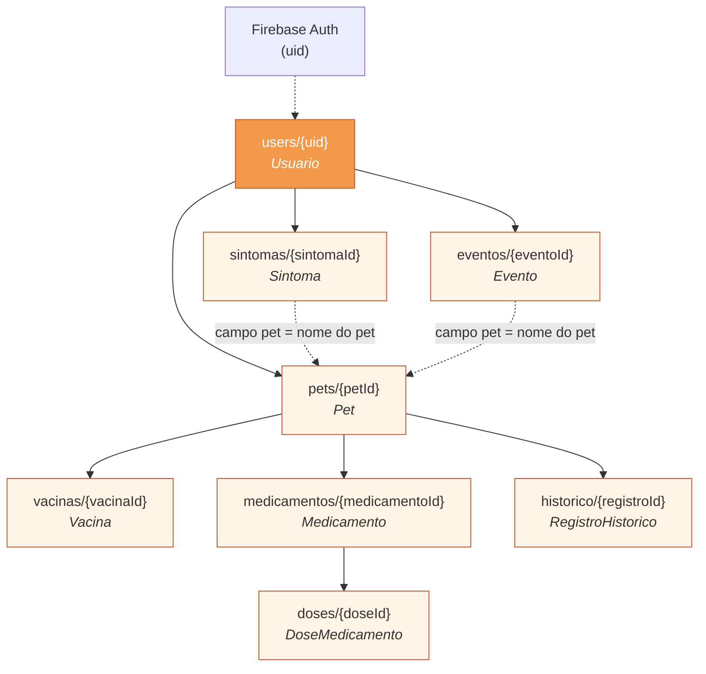
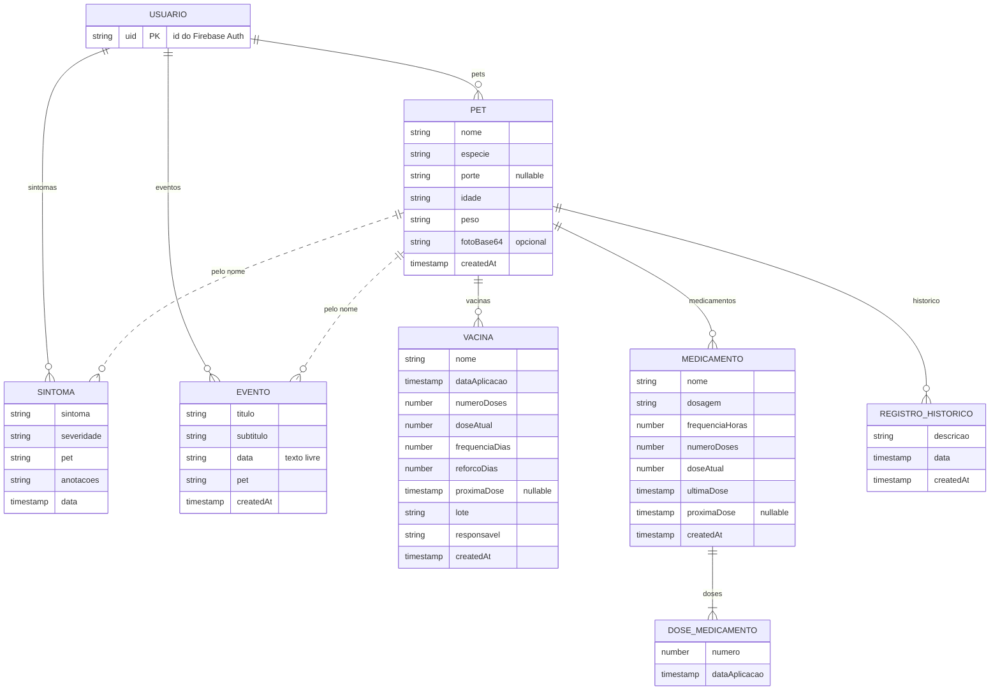
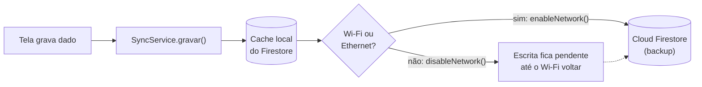
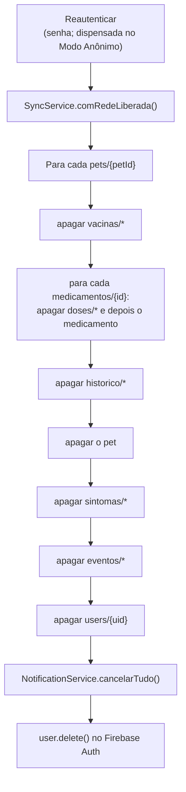

# Modelagem do Banco de Dados (Cloud Firestore) — PetVida

Este documento descreve como os dados do PetVida ficam guardados no **Cloud Firestore**: a árvore de coleções, os campos de cada documento, as consultas usadas pelas telas, as regras de segurança, a persistência offline com sincronização só em Wi-Fi e a exclusão em cascata da conta.

Tudo aqui foi tirado do código atual (`lib/screens/*.dart`, `lib/services/*.dart` e `firestore.rules`). Os nomes das entidades são os mesmos de [`diagrama-de-classes.md`](diagrama-de-classes.md).

> **Banco NoSQL orientado a documentos.** Não existem tabelas nem chaves estrangeiras: os dados ficam em **coleções** de **documentos**, e um documento pode ter **subcoleções**. No PetVida, a hierarquia em si faz o papel do relacionamento: cada dado fica "dentro" do usuário dono dele.

---

## 1. Árvore de coleções

```text
users/{uid}                                   ← Usuario (só caminho, sem campos)
├── pets/{petId}                              ← Pet
│   ├── vacinas/{vacinaId}                    ← Vacina
│   ├── medicamentos/{medicamentoId}          ← Medicamento
│   │   └── doses/{doseId}                    ← DoseMedicamento
│   └── historico/{registroId}                ← RegistroHistorico
├── sintomas/{sintomaId}                      ← Sintoma
└── eventos/{eventoId}                        ← Evento
```

- `{uid}` é o id do usuário no **Firebase Auth** (conta com e-mail/senha ou anônima).
- Os demais ids (`petId`, `vacinaId` etc.) são gerados automaticamente pelo Firestore com `collection.doc()`.
- O documento `users/{uid}` **não tem campos**: o app nunca grava nele, ele só serve de raiz do caminho. Mesmo assim, as subcoleções funcionam normalmente.
- `Clinica` e `Campanha` **não ficam no Firestore**. As clínicas e os CCZ vêm das APIs Nominatim/Overpass e as campanhas são fixas no app (veja `clinics_screen.dart`).

### 1.1 Diagrama da hierarquia



Linhas cheias = subcoleção (o filho fica dentro do pai). Linhas tracejadas = referência fraca, feita só pelo **nome** do pet.

### 1.2 Diagrama entidade-relacionamento



---

## 2. Coleções e campos

Tipos Firestore usados: `string`, `number` (inteiro), `timestamp` e `null`. Campos `createdAt` (e `data` do sintoma) são gravados com `FieldValue.serverTimestamp()`, ou seja, o horário vem do servidor.

### 2.1 `users/{uid}/pets/{petId}` — Pet

Gravado em `meus_pets_screen.dart` (criação) e `pet_profile_screen.dart` (edição e foto).

| Campo | Tipo | Obrigatório | Observação |
|---|---|---|---|
| `nome` | string | sim | |
| `especie` | string | sim | Ex.: "Cachorro", "Gato". |
| `porte` | string \| null | não | `"Pequeno"`, `"Médio"` ou `"Grande"` (`portesPet` em `porte_selector.dart`). Na criação pode ir `null`. |
| `idade` | string | sim | Texto livre (ex.: "3 anos"). |
| `peso` | string | sim | Texto livre (ex.: "12 kg"). |
| `fotoBase64` | string \| null | não | Só existe depois que o tutor escolhe uma foto (galeria/câmera, redimensionada para 400×400). Não usa Firebase Storage. |
| `createdAt` | timestamp | sim | `serverTimestamp()`. Usado para ordenar a lista de pets. |

```json
{
  "nome": "Thor",
  "especie": "Cachorro",
  "porte": "Médio",
  "idade": "3 anos",
  "peso": "12 kg",
  "fotoBase64": "/9j/4AAQSkZJRgABAQ...",
  "createdAt": "2026-10-01T14:32:10Z"
}
```

### 2.2 `users/{uid}/pets/{petId}/vacinas/{vacinaId}` — Vacina

Gravado em `pet_profile_screen.dart`. Um único documento acompanha o protocolo inteiro da vacina. Ao registrar uma nova dose, o documento é **atualizado** (não se cria outro).

| Campo | Tipo | Obrigatório | Observação |
|---|---|---|---|
| `nome` | string | sim | Ex.: "V10", "Antirrábica", "Vermífugo". |
| `dataAplicacao` | timestamp | sim | Data da **última** aplicação. |
| `numeroDoses` | number | sim | Doses do protocolo. |
| `doseAtual` | number | sim | Começa em 1 e para em `numeroDoses` (depois disso, as aplicações são reforços). |
| `frequenciaDias` | number | sim | Intervalo entre as doses do protocolo. |
| `reforcoDias` | number | sim | Intervalo do reforço depois do protocolo. |
| `proximaDose` | timestamp \| null | sim | Calculada pela regra RN02 (`_calcularProximaDose`). `null` quando não há próxima dose. |
| `lote` | string | sim | Lote da última aplicação. Pode ser `""`. |
| `responsavel` | string | sim | Veterinário/responsável da última aplicação. Pode ser `""`. |
| `createdAt` | timestamp | sim | `serverTimestamp()`. |

```json
{
  "nome": "V10",
  "dataAplicacao": "2026-09-15T00:00:00Z",
  "numeroDoses": 3,
  "doseAtual": 2,
  "frequenciaDias": 21,
  "reforcoDias": 365,
  "proximaDose": "2026-10-06T00:00:00Z",
  "lote": "A1234B",
  "responsavel": "Dra. Ana Souza",
  "createdAt": "2026-08-25T10:00:00Z"
}
```

### 2.3 `users/{uid}/pets/{petId}/medicamentos/{medicamentoId}` — Medicamento

Gravado em `medicamentos_screen.dart`.

| Campo | Tipo | Obrigatório | Observação |
|---|---|---|---|
| `nome` | string | sim | |
| `dosagem` | string | sim | Ex.: "1 comprimido", "5 ml". |
| `frequenciaHoras` | number | sim | Intervalo entre doses, em horas. |
| `numeroDoses` | number | sim | Total de doses do tratamento. |
| `doseAtual` | number | sim | Começa em 1 (a criação já registra a primeira dose). |
| `ultimaDose` | timestamp | sim | Momento da última dose registrada. |
| `proximaDose` | timestamp \| null | sim | `ultimaDose + frequenciaHoras`; `null` quando o tratamento termina. |
| `createdAt` | timestamp | sim | `serverTimestamp()`. |

```json
{
  "nome": "Amoxicilina",
  "dosagem": "1 comprimido",
  "frequenciaHoras": 12,
  "numeroDoses": 14,
  "doseAtual": 3,
  "ultimaDose": "2026-10-30T08:00:00Z",
  "proximaDose": "2026-10-30T20:00:00Z",
  "createdAt": "2026-10-29T08:00:00Z"
}
```

#### `.../medicamentos/{medicamentoId}/doses/{doseId}` — DoseMedicamento

Uma dose é gravada a cada aplicação (inclusive a primeira, junto com a criação do medicamento). Forma o histórico completo de administração.

| Campo | Tipo | Obrigatório | Observação |
|---|---|---|---|
| `numero` | number | sim | Número da dose (1, 2, 3…). |
| `dataAplicacao` | timestamp | sim | Momento em que a dose foi registrada. |

```json
{
  "numero": 3,
  "dataAplicacao": "2026-10-30T08:00:00Z"
}
```

### 2.4 `users/{uid}/pets/{petId}/historico/{registroId}` — RegistroHistorico

Gravado em `historico_medico_screen.dart`.

| Campo | Tipo | Obrigatório | Observação |
|---|---|---|---|
| `descricao` | string | sim | Ex.: "Consulta de rotina". |
| `data` | timestamp | sim | Data escolhida no formulário. |
| `createdAt` | timestamp | sim | `serverTimestamp()`. |

```json
{
  "descricao": "Consulta de rotina",
  "data": "2026-10-20T00:00:00Z",
  "createdAt": "2026-10-20T16:45:00Z"
}
```

### 2.5 `users/{uid}/sintomas/{sintomaId}` — Sintoma

Gravado em `symptom_diary_screen.dart`. Os registros não são editados depois de criados (RN03).

| Campo | Tipo | Obrigatório | Observação |
|---|---|---|---|
| `sintoma` | string | sim | `"Febre"`, `"Apetite"`, `"Letargia"`, `"Vômito"` ou `"Tosse"`. |
| `severidade` | string | sim | `"Baixo"`, `"Médio"` ou `"Alto"`. |
| `pet` | string | sim | **Nome** do pet (não o `petId`). |
| `anotacoes` | string | sim | Pode ser `""`. |
| `data` | timestamp | sim | `serverTimestamp()`: o momento do registro. |

```json
{
  "sintoma": "Vômito",
  "severidade": "Médio",
  "pet": "Thor",
  "anotacoes": "Vomitou depois do almoço.",
  "data": "2026-10-28T13:10:00Z"
}
```

### 2.6 `users/{uid}/eventos/{eventoId}` — Evento

Gravado em `timeline_screen.dart`.

| Campo | Tipo | Obrigatório | Observação |
|---|---|---|---|
| `titulo` | string | sim | |
| `subtitulo` | string | sim | Pode ser `""`. |
| `data` | string | sim | **Texto livre** digitado pelo tutor (ex.: "12/11"). Se ficar vazio, grava `"Hoje"`. |
| `pet` | string | sim | **Nome** do pet. |
| `createdAt` | timestamp | sim | `serverTimestamp()`. É ele que ordena a linha do tempo. |

```json
{
  "titulo": "Banho e tosa",
  "subtitulo": "Pet shop do bairro",
  "data": "12/11",
  "pet": "Thor",
  "createdAt": "2026-10-30T09:00:00Z"
}
```

> Nos exemplos JSON, os `timestamp` aparecem como texto ISO 8601 só para facilitar a leitura. No Firestore eles são do tipo `Timestamp`.

---

## 3. Consultas usadas

Todas as listas usam `snapshots()` (atualização em tempo real, inclusive a partir do cache local). Nenhuma consulta precisa de **índice composto**: todas usam um único campo.

| Tela / arquivo | Coleção | Consulta | Uso |
|---|---|---|---|
| `home_screen.dart` | `pets` | `orderBy('createdAt')` | Pets da tela inicial. |
| `meus_pets_screen.dart` | `pets` | `orderBy('createdAt')` | Lista "Meus Pets". |
| `pet_profile_screen.dart` | `pets/{petId}` | `doc.snapshots()` | Dados do perfil do pet. |
| `pet_profile_screen.dart` | `vacinas` | `orderBy('dataAplicacao', descending: true)` | Carteira de vacinação e PDF. |
| `pet_profile_screen.dart` | `sintomas` | `where('pet', isEqualTo: nomePet)` + ordenação em memória por `data` | Sintomas no PDF do histórico (RF09). |
| `medicamentos_screen.dart` | `medicamentos` | `orderBy('createdAt', descending: true)` | Lista de medicamentos. |
| `medicamentos_screen.dart` | `doses` | `orderBy('numero')` | Histórico de doses. |
| `historico_medico_screen.dart` | `historico` | `orderBy('data', descending: true)` | Histórico médico. |
| `symptom_diary_screen.dart` | `sintomas` | `orderBy('data', descending: true)` | Diário de sintomas. |
| `timeline_screen.dart` | `eventos` | `orderBy('createdAt', descending: true)` | Linha do tempo (o filtro por pet é feito em memória). |
| `symptom_diary_screen.dart`, `timeline_screen.dart` | `pets` | `get()` | Nomes dos pets para o seletor. |

**Por que o PDF ordena os sintomas em memória:** combinar `where('pet', ...)` com `orderBy('data')` (campos diferentes) exigiria criar um índice composto no console do Firebase. Para evitar isso, a consulta usa só o `where` e a lista é ordenada no app (`sort` por `data`, da mais recente para a mais antiga).

---

## 4. Regras de segurança (`firestore.rules`)

```js
rules_version = '2';

service cloud.firestore {
  match /databases/{database}/documents {
    match /users/{userId} {
      allow read, write: if request.auth != null && request.auth.uid == userId;

      match /{document=**} {
        allow read, write: if request.auth != null && request.auth.uid == userId;
      }
    }
  }
}
```

- Só um usuário **autenticado** (inclusive no Modo Anônimo) acessa o banco.
- Cada usuário só lê e grava dentro de `users/{seu próprio uid}`. O curinga `{document=**}` estende a regra a todas as subcoleções (pets, vacinas, medicamentos, doses, histórico, sintomas e eventos).
- Qualquer caminho fora de `users/` é negado por padrão.
- Isso garante o isolamento dos dados entre tutores (privacidade/LGPD). As regras não validam os campos nem os tipos: essa validação é feita pelos formulários do app.

---

## 5. Persistência offline e sincronização só em Wi-Fi

Implementado em `lib/services/sync_service.dart` (classe `SyncService`), iniciado em `main.dart` logo depois de `Firebase.initializeApp` (RF10, RF11, RNF02).



1. **Cache local ilimitado:** `Settings(persistenceEnabled: true, cacheSizeBytes: Settings.CACHE_SIZE_UNLIMITED)`. Todas as leituras e escritas passam pelo cache, então a carteira de vacinação abre mesmo sem internet.
2. **Política de rede:** com `connectivity_plus`, o serviço observa o tipo de conexão. Em **Wi-Fi ou Ethernet** chama `enableNetwork()`; em dados móveis ou sem conexão chama `disableNetwork()`. O `ValueNotifier<bool> backupAtivo` informa a interface se o backup está ativo.
3. **`gravar(escrita)`:** o Firestore aplica a escrita no cache na hora, mas o `Future` só termina quando o servidor confirma. Com o backup pausado, o serviço não espera esse `Future` (evita travar a tela) e só registra no log se ele falhar depois. As escritas pendentes são enviadas automaticamente quando o Wi-Fi volta.
4. **`comRedeLiberada(acao)`:** libera a rede temporariamente, mesmo fora do Wi-Fi, para uma ação que precisa do servidor (a exclusão definitiva da conta). No fim, volta a seguir a política de Wi-Fi.
5. **Falha ao detectar a rede:** se não for possível verificar a conexão, o Firestore fica online (comportamento padrão).

---

## 6. Exclusão em cascata da conta (`perfil_screen.dart`)

O Firestore **não apaga subcoleções** quando o documento pai é apagado. Por isso, a exclusão de conta (RF12/LGPD) percorre a árvore e apaga cada documento, de baixo para cima (`_excluirTodosOsDados`):



- A rede é liberada mesmo fora do Wi-Fi para que o **backup no servidor** também seja apagado, e não só o cache local.
- Os lembretes locais são cancelados e, por último, a conta é removida do Firebase Auth.

---

## 7. Observações sobre a modelagem atual

Pontos encontrados no código, complementando a seção 4 de [`diagrama-de-classes.md`](diagrama-de-classes.md):

1. **Referência pelo nome:** `sintomas.pet` e `eventos.pet` guardam o nome do pet. Renomear o pet quebra o vínculo com os registros antigos. Gravar também `petId` resolveria.
2. **`eventos.data` é texto:** não dá para ordenar por data real; a ordenação usa `createdAt`.
3. **Vacina guarda só a última aplicação:** `dataAplicacao`, `lote` e `responsavel` são sobrescritos a cada dose. Uma subcoleção `aplicacoes` (como `doses` em medicamentos) guardaria o histórico.
4. **`idade` e `peso` são texto:** `dataNascimento` (timestamp) e `pesoKg` (number) permitiriam cálculos e gráficos de evolução.
5. **Exclusão de pet incompleta:** em `pet_profile_screen.dart`, excluir um pet apaga só a subcoleção `vacinas` e o documento do pet; `medicamentos` (com `doses`) e `historico` ficam órfãos no banco. A exclusão de conta não tem esse problema, porque percorre todas as subcoleções.
6. **Exclusão de medicamento:** em `medicamentos_screen.dart`, remover um medicamento apaga o documento mas não a subcoleção `doses`.
